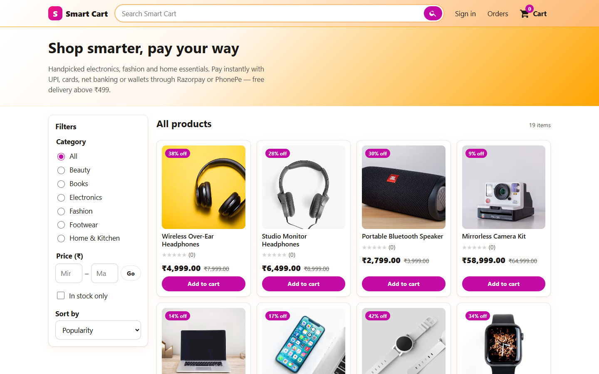
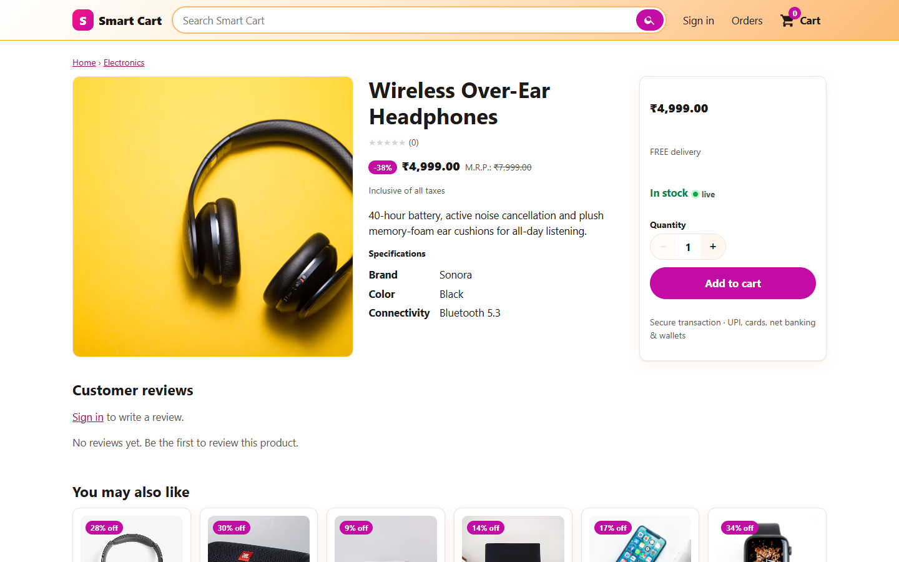
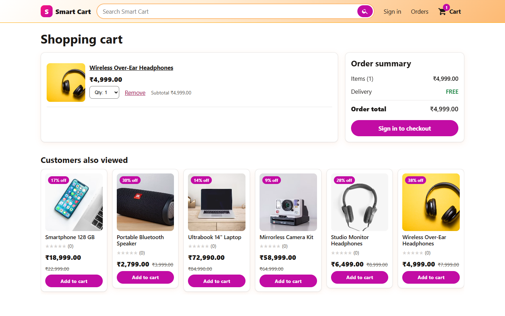
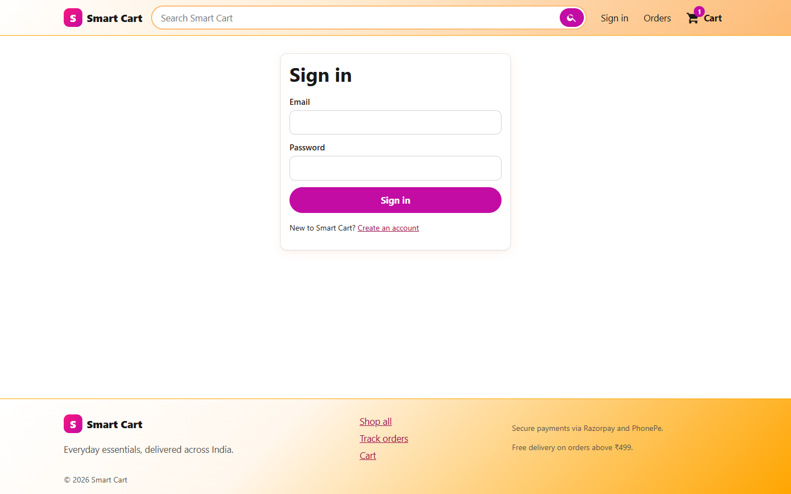
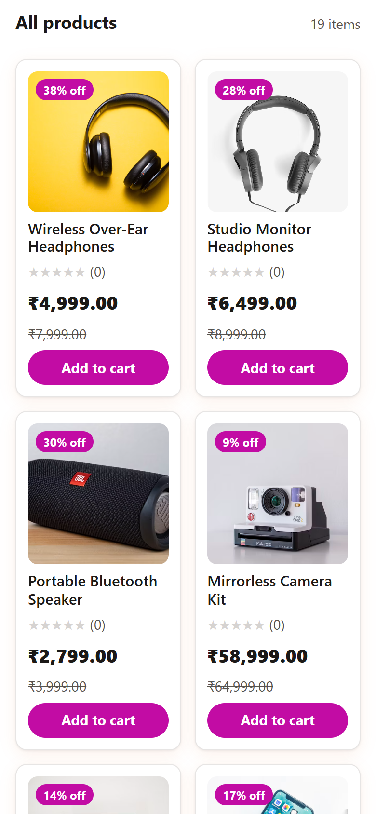
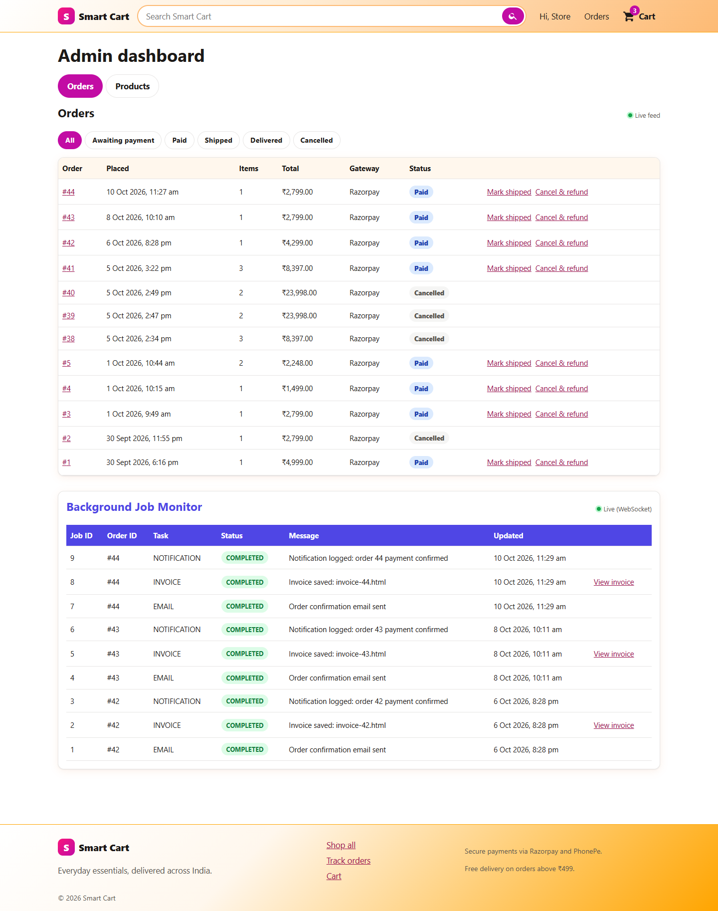
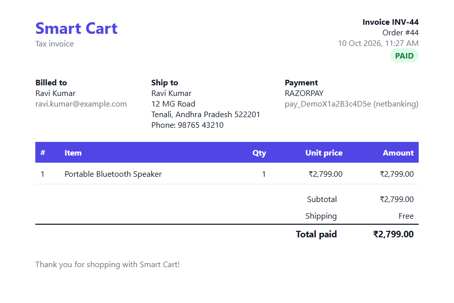
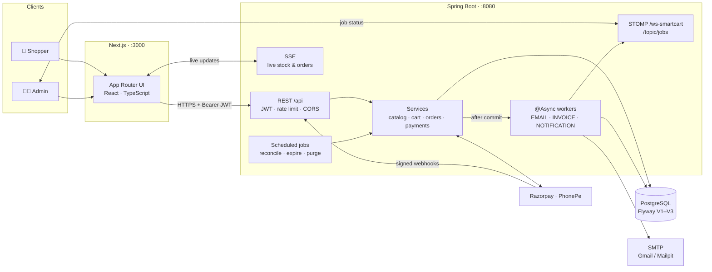
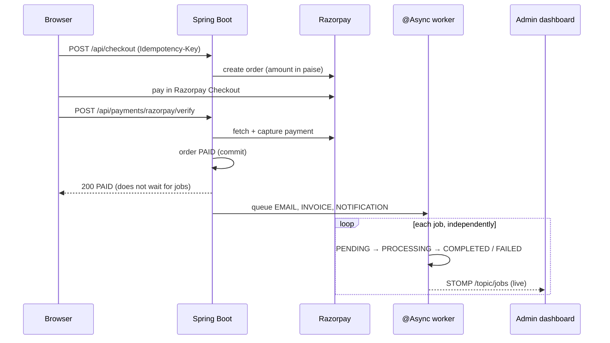

<div align="center">

# 🛍️ Smart Cart

### Full-stack e-commerce platform with real-time payments, background jobs and live updates

Shoppers browse a searchable catalogue with **live stock**, check out with **UPI, cards, net banking or wallets** through **Razorpay** (or PhonePe), and get **email confirmations and invoices** produced by background workers. Admins run the store from a dashboard whose order feed and **background job monitor** update in real time over **SSE and WebSocket (STOMP)**.

[](https://github.com/dheerajdonepudi14/SmartCart/actions/workflows/ci.yml)


[](LICENSE)



[Features](#-features) · [Screenshots](#-screenshots) · [Architecture](#%EF%B8%8F-architecture) · [Tech stack](#-tech-stack) · [Getting started](#-getting-started) · [Configuration](#%EF%B8%8F-configuration) · [API](#-api) · [Deployment](#%EF%B8%8F-deployment)

</div>

---

## ✨ Features

<table>
<tr>
<td width="33%" valign="top">

### 🛒 Shopper
- Catalogue with categories, price range, in-stock filter and sorting
- Instant search with suggestions
- Product pages with specs, image carousel and **verified-purchase reviews**
- **Live stock** ("Only 3 left", sold-out) pushed over SSE
- Guest cart that merges into the account on sign-in
- Free-delivery threshold and server-calculated totals
- **Razorpay Checkout**: UPI, cards, net banking, wallets, EMI (PhonePe also supported)
- Order history and **live order tracking**
- Email for signup, payment received/failed, shipped, delivered, cancelled

</td>
<td width="33%" valign="top">

### 🧑‍💼 Admin
- **Live order feed** across the store (SSE)
- Ship, deliver, or cancel with **automatic refund**
- Product & category management, restock with live stock push
- **Background Job Monitor**: EMAIL · INVOICE · NOTIFICATION jobs moving `PENDING → PROCESSING → COMPLETED / FAILED` in real time over **WebSocket + STOMP**
- **Retry** failed jobs, open generated **HTML invoices**

### 🔐 Accounts
- JWT access token in memory + **rotating HttpOnly refresh cookie**
- Refresh-token reuse detection revokes the whole session
- Role-based access: customer · admin

</td>
<td width="33%" valign="top">

### ⚙️ Platform
- **Exactly-once payments**: signature check, server-side fetch, capture, row locks
- Idempotent checkout (`Idempotency-Key`), de-duplicated webhooks
- Reconciliation job and automatic refunds for duplicates/late payments
- **Async background jobs** (`@Async` thread pool) after payment verification
- Stock reservation with expiry of unpaid orders
- Flyway migrations, Swagger UI, Prometheus metrics
- Rate limiting, strict CSP, HSTS
- Postman collection, CI pipeline, Kubernetes manifests
- One-click deploy: **Render** (API + DB) + **Vercel** (frontend)

</td>
</tr>
</table>

---

## 📸 Screenshots

> Captured from a local run with the seeded demo catalogue. Customer details in the invoice are demo data.

### Storefront

| Product page | Cart |
|:---:|:---:|
|  |  |
| **Sign in** | **Phone view** |
|  |  |

### Admin & background jobs

| Admin dashboard — live orders + Background Job Monitor | Invoice generated by the INVOICE job |
|:---:|:---:|
|  |  |

---

## 🏗️ Architecture



### Payment → background jobs



The webhook and the reconciliation job end in the same `PaymentRecorder`, so jobs are queued exactly once per order whichever path confirms the payment first.

---

## 🧰 Tech stack

| Layer | Technologies |
|---|---|
| **Frontend** | Next.js 16 (App Router), React 19, TypeScript (strict), STOMP.js, Vitest + Testing Library |
| **Backend** | Java 17, Spring Boot 3.3 (Web, Security, Data JPA, Validation, WebSocket, Mail, Actuator), JJWT, springdoc-openapi, Micrometer/Prometheus |
| **Database** | PostgreSQL 16, Flyway migrations, row-level locks for stock and payments, JSONB + trigram indexes |
| **Payments** | Razorpay Orders + Checkout + Webhooks + Refunds, PhonePe Standard Checkout v2 |
| **Async & real-time** | `@Async` ThreadPoolTaskExecutor, `@TransactionalEventListener`, SSE, WebSocket + STOMP |
| **Email** | Spring JavaMailSender (Gmail SMTP with App Password, or Mailpit locally) |
| **DevOps** | Docker & Docker Compose, GitHub Actions, Kubernetes manifests, Render Blueprint, Vercel, Postman/Newman |

---

## 📁 Project structure

```text
SmartCart/
├── backend/                          Spring Boot API
│   ├── src/main/java/com/smartcart/
│   │   ├── auth/                     JWT access tokens, rotating refresh tokens
│   │   ├── catalog/                  products, categories, search, live stock (SSE)
│   │   ├── cart/                     server cart + guest-cart merge
│   │   ├── order/                    orders, stock reservation, live status (SSE)
│   │   ├── payment/                  Razorpay + PhonePe, webhooks, reconciliation, refunds
│   │   ├── job/                      background jobs, worker, invoices, STOMP publisher
│   │   ├── notification/             email templates + sender
│   │   ├── review/ · user/ · common/
│   │   └── config/                   security, async pool, WebSocket, rate limit, seed
│   ├── src/main/resources/db/migration/   Flyway V1 … V3
│   └── Dockerfile
├── frontend/                         Next.js storefront & admin
│   ├── src/app/                      /, /products/[id], /cart, /checkout, /pay/[orderId],
│   │                                 /orders, /orders/[id], /admin, /login, /register
│   ├── src/components/               UI incl. BackgroundJobMonitor
│   ├── src/lib/                      API client, SSE client, payment flow
│   └── Dockerfile
├── k8s/                              namespace, deployments, HPA, ingress
├── postman/                          API collection + environment + Newman runner
├── docs/screenshots/
├── docker-compose.yml                db · mailpit · backend · frontend
├── render.yaml                       Render Blueprint (API + PostgreSQL)
├── start.ps1                         one-command local setup on Windows
├── DEPLOY.md                         Render + Vercel guide
└── .env.example                      every setting, documented
```

---

## 🚀 Getting started

### Prerequisites

- **Docker Desktop** — all you need for the quick start.
- Without Docker: JDK 17+, Maven 3.9+, Node.js 20.9+ and PostgreSQL 14+.

### Quick start (Docker)

```bash
git clone https://github.com/dheerajdonepudi14/SmartCart.git
cd SmartCart
cp .env.example .env          # add Razorpay test keys to take payments
docker compose up --build
```

On Windows, `powershell -ExecutionPolicy Bypass -File .\start.ps1` does all of that, waits until the app is up and opens the browser (`-Stop` to stop).

| Service | URL |
|---|---|
| Storefront | http://localhost:3000 |
| Admin dashboard | http://localhost:3000/admin |
| REST API | http://localhost:8100/api |
| Swagger UI | http://localhost:8100/swagger-ui.html |
| Mailpit (local inbox) | http://localhost:8025 |

The seeded admin is `admin@smartcart.local` / `Admin@12345` (change `ADMIN_EMAIL` / `ADMIN_PASSWORD` before the first start). Register any account to shop.

**Payments are real only.** Put Razorpay **test** keys (`rzp_test_…`) in `.env` and pay with UPI `success@razorpay` (or `failure@razorpay`) — no real money moves. Without keys, checkout returns `503 Razorpay is not configured`.

### Without Docker

```bash
createdb smartcart                                   # Flyway creates the schema
cd backend  && mvn spring-boot:run                   # :8080
cd frontend && npm ci && npm run dev                 # :3000
```

---

## ⚙️ Configuration

All settings are environment variables; [`.env.example`](.env.example) documents every one.

| Area | Variables |
|---|---|
| Database | `POSTGRES_USER`, `POSTGRES_PASSWORD` (or `SPRING_DATASOURCE_URL` / `DB_HOST`, `DB_PORT`, `DB_NAME`) |
| Auth | `JWT_SECRET` (≥ 32 bytes), `JWT_COOKIE_SECURE` |
| URLs | `FRONTEND_URL`, `CORS_ALLOWED_ORIGINS`, `NEXT_PUBLIC_API_URL`, `NEXT_PUBLIC_AUTH_URL`, `BACKEND_URL` |
| Razorpay | `RAZORPAY_KEY_ID`, `RAZORPAY_KEY_SECRET`, `RAZORPAY_WEBHOOK_SECRET` |
| PhonePe | `PHONEPE_CLIENT_ID`, `PHONEPE_CLIENT_SECRET`, `PHONEPE_ENV`, webhook user/password |
| Email | `MAIL_ENABLED`, `MAIL_HOST`, `MAIL_PORT`, `MAIL_USERNAME`, `MAIL_PASSWORD`, `MAIL_FROM` |
| Seed | `SEED_ENABLED`, `ADMIN_EMAIL`, `ADMIN_PASSWORD` |

### Email

Locally, emails go to **Mailpit** at http://localhost:8025. For real inboxes use Gmail SMTP: `MAIL_HOST=smtp.gmail.com`, `MAIL_PORT=587`, `MAIL_SMTP_AUTH=true`, `MAIL_SMTP_STARTTLS=true` and a 16-character **Google App Password** (Google Account → Security → 2-Step Verification → App passwords). Email is sent after the database commit on a background thread, so a mail outage never slows down or breaks checkout.

### Razorpay

1. Dashboard → **API Keys → Generate Key** (Test mode) → `RAZORPAY_KEY_ID` / `RAZORPAY_KEY_SECRET`.
2. **Webhooks → Add**: `https://<api>/api/webhooks/razorpay`, a secret (`RAZORPAY_WEBHOOK_SECRET`), events `payment.authorized`, `payment.captured`, `payment.failed`, `order.paid`. Locally, expose port 8100 with `ngrok` or `cloudflared`.

---

## 💳 Payments: exactly once

Every confirmation path — browser callback, webhook, reconciler — ends in `PaymentRecorder`, which row-locks the payment row.

| Risk | Protection |
|---|---|
| Double-click / network retry on checkout | `Idempotency-Key` → same order (unique `user_id + idempotency_key`) |
| Retrying a failed payment | The open Razorpay order is reused |
| Same callback twice / webhook redelivery | Row lock + status check; webhook event ids stored |
| Two captures for one order | Second is refunded automatically, retried until it succeeds |
| Payment after the order expired | Stock re-reserved if available, otherwise auto-refunded |
| Admin cancels a paid order | Payment refunded automatically |
| Forged signature / wrong amount / unknown payment | Rejected — the payment is fetched from Razorpay and cross-checked |

---

## 📡 API

| Method | Path | Auth |
|---|---|---|
| POST | `/api/auth/register` · `/login` · `/refresh` · `/logout` | – |
| GET | `/api/products`, `/api/products/{id}`, `/api/categories`, `/api/search`, `/api/recommendations` | – |
| GET | `/api/products/stock/stream` (SSE live stock) | – |
| GET · POST · DELETE | `/api/cart`, POST `/api/cart/merge` | user |
| POST | `/api/checkout`, `/api/orders/{id}/pay`, `/api/orders/{id}/cancel` | user |
| GET | `/api/orders`, `/api/orders/{id}`, `/api/orders/{id}/events` (SSE) | user |
| POST | `/api/payments/razorpay/verify` | user |
| POST | `/api/webhooks/razorpay`, `/api/webhooks/phonepe` | gateway signature |
| GET · POST | `/api/reviews?productId=`, `/api/reviews` | – / user |
| GET · PUT | `/api/admin/orders`, `/api/admin/orders/{id}/status`, `/api/admin/orders/events` (SSE) | admin |
| POST · PUT · DELETE | `/api/products`, `/api/categories` | admin |
| GET · POST | `/api/jobs`, `/api/jobs/order/{id}`, `/api/jobs/{jobId}/retry`, `/api/jobs/invoices/{orderId}` | admin |
| STOMP | `/ws-smartcart` → subscribe `/topic/jobs` (admin JWT on `CONNECT`) | admin |

Full interactive docs: **Swagger UI** at `/swagger-ui.html`. A ready-made **Postman** collection lives in [`postman/`](postman/) (`./postman/run-newman.sh` for the command line).

---

## 🧪 Testing

```bash
cd backend  && mvn verify                                    # 24 tests, no network needed
cd frontend && npm run lint && npm run typecheck && npm test # 21 tests
```

- **Backend** — MockMvc + H2 with an in-process Razorpay API stub: auth roles and refresh-token reuse, idempotent checkout, verify → capture exactly once, forged signatures and wrong amounts rejected, webhook-only confirmation, duplicate capture auto-refunded, and **background jobs** (EMAIL fails on its own while INVOICE and NOTIFICATION complete, no duplicate jobs, retry).
- **Frontend** — payment flow, formatting, guest cart, validation, components, job-monitor merge logic.

GitHub Actions ([`ci.yml`](.github/workflows/ci.yml)) builds and tests both apps on every push and pull request, and builds Docker images on `main`.

---

## ☁️ Deployment

**Render** (Spring Boot API + PostgreSQL via [`render.yaml`](render.yaml)) and **Vercel** (Next.js frontend). Sign-in calls are proxied through the frontend so the refresh cookie stays first-party across the two domains. Step-by-step: **[DEPLOY.md](DEPLOY.md)**. Kubernetes manifests are in [`k8s/`](k8s/).

---

## 🔒 Security

- No secrets are committed: configuration comes from `.env` (git-ignored); `.env.example` has placeholders only.
- Access token (15 min) kept in memory; refresh token (7 days) in an HttpOnly cookie, stored hashed, **rotated on every use**, reuse revokes the session family.
- BCrypt passwords, role checks on every REST route and on the WebSocket `CONNECT` frame.
- Webhook signatures compared in constant time; amounts cross-checked with the gateway.
- Rate limiting on login/register, CORS restricted to the frontend, CSP allowing only Razorpay, HSTS.
- The seeded admin password and default `JWT_SECRET` are for local use only — set your own before deploying.

---

## 📄 License

Released under the [MIT License](LICENSE).

## 👤 Author

**Dheeraj Donepudi** · GitHub [@dheerajdonepudi14](https://github.com/dheerajdonepudi14)
